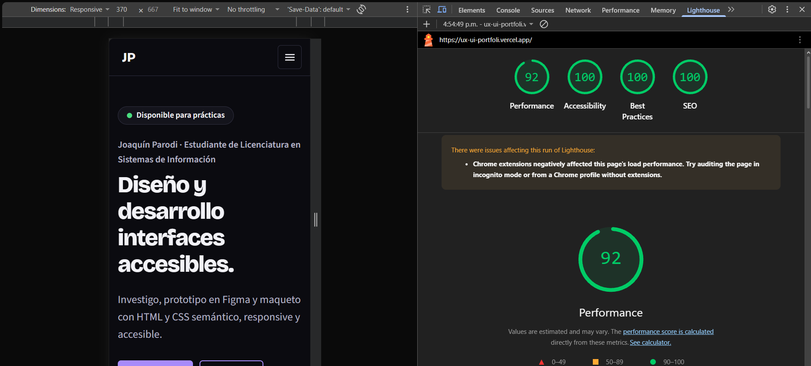

# Portfolio web personal · Joaquín Parodi

Trabajo final de **Diseño UX-UI 2026** · Licenciatura en Sistemas de Información · FCyT, Sede Concepción del Uruguay · Cátedra del Mg. Ernesto Ledesma.

## Enlaces

| Qué | Dónde |
|---|---|
| Sitio publicado | https://ux-ui-portfoli.vercel.app |
| Repositorio | https://github.com/joaparodi/ux-ui (carpeta `portfolio-ux-ui`) |
| Figma del portfolio (un solo archivo con 3 páginas: Design System, Design System · Componentes y Research · Wireframes · Prototipo) | https://www.figma.com/design/U5EX87DpdOJDKsDdnTVcZG |
| Figma de alta fidelidad del portfolio (prototipo mobile y desktop) | https://www.figma.com/design/sdZSSOorsVWF1U6rAfyNy9/Sin-t%C3%ADtulo?t=ZMz5gLQLcO0rGnY0-0 |
| Figma de Cubrí Seguros | https://www.figma.com/make/06ILLeUcyiwDLk7DUeTGv5/prototipo-cubrir-seguros?t=1BXRyhtX3OCKdivl-0 |
| Figma de Coffea | No aplica: la landing se realizó sin Figma |
| Figma de BarberTurn | https://www.figma.com/make/IwDEMx60cwZLFeE5sRJtNY/Crear-app-interactiva?t=Gbi7JT6UshvwRUVa-1 |
| Figma de OpenArt (proyecto en grupo) | Prototipo: https://www.figma.com/design/fCEgA4SxXE9FUvz57fxpeg/Prototipo-Open-Art · Demo: https://www.figma.com/make/YLGpsJolgT38wdEHEGE7cG/Demo |

## Referencias e inspiración (originalidad)

- **Referencia de la cátedra:** portfolio del docente (https://ernesto-ledesma-portfolio.vercel.app/). Otras fuentes de inspiración sugeridas: Behance (búsquedas "UX portfolio" y "case study"), Land-book, Godly y Minimal Gallery.
- **Qué se tomó como principio:** la arquitectura de información que exige el TP (one-page con las 9 secciones), el tema oscuro como punto de partida y la grilla de tarjetas para resumen, habilidades y proyectos.
- **Qué es propio:**
  - Paleta negro y violeta definida como design system en Figma (variables con los mismos nombres que en CSS) y modo claro opcional.
  - Tipografía Bricolage Grotesque y Source Sans 3.
  - Proyectos con capturas reales y casos de estudio (un modal y una página propia).
  - Línea de tiempo con puntos, foto recortada y textos y contenido propios.
- **Qué no se reutilizó:** logos, nombres, imágenes, textos ni códigos de color de la referencia ni de ninguna marca real.
- En el PDF del proceso va una slide "Referencia vs. mi diseño" con esta comparación.

## Concepto visual

- **Palabras clave:** preciso, sobrio y cercano.
  - *Preciso:* grilla y espaciado en múltiplos de 4, tipografía con interletrado ajustado y componentes consistentes.
  - *Sobrio:* fondo negro, pocas superficies y un solo color de acento (violeta).
  - *Cercano:* tono directo en voseo ("Escribime"), foto propia y esquinas redondeadas.
- **Color:** fondo negro con violeta como color de detalle; modo claro opcional con el botón del header.
- **Tipografía:** Bricolage Grotesque (títulos) y Source Sans 3 (texto), con `font-display: swap`.
- **Imágenes:** foto propia y mockups de los proyectos.

## Stack

HTML5 semántico, CSS3 puro (variables en `:root`, Flexbox y Grid) y JavaScript vanilla con módulos ES. Sin frameworks ni paso de compilación: el sitio se sirve tal como está en el repositorio. Se eligió CSS puro en lugar de Tailwind para evitar compilar y no depender del CDN.

## Estructura del proyecto

```
index.html        contenido, metadatos y caso de estudio (<dialog>)
css/styles.css    tokens del design system, componentes, secciones y breakpoints
js/main.js        punto de entrada que inicia los módulos
js/nav.js         menú mobile (aria-expanded y aria-controls)
js/scrollspy.js   marca la sección activa en el menú
js/theme.js       modo oscuro/claro
js/modal.js       caso de estudio en un modal nativo
js/case.js        tema oscuro/claro en la página de caso de estudio
assets/           favicon e imágenes
casos/           páginas propias de casos de estudio (barberturn.html)
docs/            capturas y plantilla del test de usabilidad
404.html          página de error personalizada
vercel.json       headers de seguridad para Vercel
```

La separación en `index.html`, un CSS y un módulo JS por responsabilidad permite cambiar una parte sin romper el resto. El contenido y la navegación funcionan aunque JavaScript falle (mejora progresiva).

## Cumplimiento de los requisitos del TP

| Requisito | Dónde se resuelve |
|---|---|
| 9 secciones y navegación por anclas | `index.html` (`section` con `id`) |
| Header sticky y menú hamburguesa | `.site-header`, `js/nav.js` |
| Un solo `h1`, jerarquía sin saltos, `alt` y enlaces externos seguros | `index.html` |
| Variables CSS, Flexbox y Grid | `:root` y `.grid` en `css/styles.css` |
| Mobile-first y breakpoints 375, 768 y 1280 px | `@media` al final de `css/styles.css` |
| Estados `hover`, `focus-visible` y `active` | botones, enlaces y tarjetas |
| `scroll-behavior` y `scroll-margin-top` | `html` y `section[id]` |
| Contraste AA, teclado y link "Saltar al contenido" | `.skip-link`, tokens de color |
| `prefers-reduced-motion` | final de `css/styles.css` |
| Caso de estudio | página propia `casos/barberturn.html` y modal de Cubrí Seguros (`<template id="case-cubri">`) |
| Bonus: modo claro/oscuro, 404 y headers | `js/theme.js`, `404.html`, `vercel.json` |

## Pruebas realizadas

- Navegador real (Chromium) en 375, 768 y 1280 px: sin scroll horizontal y sin errores de JavaScript.
- Menú mobile (abrir, cerrar y tecla Esc), modal, cambio de tema.
- Auditoría de HTML: un solo `h1`, sin saltos de encabezados, sin ids duplicados ni anclas rotas, imágenes con `alt`, `width` y `height`.
- Contraste de los pares de color de ambos temas, por encima de 4,5:1.
- Lighthouse mobile (370 x 667) sobre la URL de producción https://ux-ui-portfoli.vercel.app: **Performance 92, Accessibility 100, Best Practices 100 y SEO 100**. Captura en `docs/capturas/lighthouse-vercel.png`.
- Scroll horizontal: sin desborde en 14 anchos (280 a 1440 px), en modo claro y oscuro, en el inicio, el caso de estudio y la 404.
- Menú hamburguesa (ícono con etiqueta accesible) y cambio de tema.

## Despliegue (Vercel desde GitHub)

1. Subir los cambios al repositorio (`git push origin main`).
2. En Vercel: **Add New → Project → Import Git Repository** y elegir el repo `ux-ui`.
3. Configurar **Framework Preset** = `Other`, **Root Directory** = `portfolio-ux-ui`, sin **Build Command** y sin **Output Directory**.
4. Cada push a `main` dispara un nuevo despliegue automático con HTTPS (y un preview por cada pull request).
5. Agregar la URL en este README y en la descripción del repositorio (GitHub → About → engranaje → Website).

Los headers de seguridad se configuran en `vercel.json`. La página `404.html` se sirve automáticamente para rutas inexistentes.

## Fuentes y recursos

- Sin template: el diseño y el código son propios para este trabajo.
- Fuentes: Google Fonts (Bricolage Grotesque y Source Sans 3).
- Capturas reales de Cubrí Seguros, Coffea y BarberTurn (esta última, de las pantallas del enunciado). Capturas reales de OpenArt (exportadas de su Figma) y de Mesa de Ayuda (con los datos personales tapados).
- Fotografía propia, recortada en círculo.

## Uso de IA

Se usó **Claude (Anthropic)** como asistente, según la política de la cátedra.

**Qué se generó con IA**
- El código inicial: HTML, CSS con variables y los módulos JavaScript (`nav`, `scrollspy`, `theme`, `modal` y `main`).
- Textos de ejemplo del sitio y los mockups SVG provisorios.
- El informe de conceptos clave del TP y este README.

**Qué es propio**
- Todos los datos personales, la elección y el contenido de los proyectos (trabajos reales de la carrera), la foto y los links.
- La decisión de la paleta negro y violeta, la elección de qué proyectos mostrar y su orden.
- El proceso UX/UI (usuario, benchmark, concepto, wireframes y design system en Figma) y el test de usabilidad con 3 personas.

**Cómo se revisó**
- Se leyó el código y se probó en un navegador en 375, 768 y 1280 px, con menú, modal y cambio de tema.
- Se auditó el HTML y se calculó el contraste de colores.
- Los textos de los proyectos se contrastaron con los documentos originales; se eliminaron o corrigieron las afirmaciones que no se podían verificar (por ejemplo, resultados de un test que todavía no se había hecho).

## Proceso UX/UI

El detalle de cada etapa está en el PDF del proceso (`docs/Proceso_UXUI_Portfolio_Joaquin_Parodi.pdf`).

| Etapa | Estado |
|---|---|
| Usuario objetivo y proto-persona | Hecho (slide 2 del PDF): selección técnica que mira perfiles desde el celular |
| Benchmark de 3 portfolios | Hecho (slide 3): Ernesto Ledesma, Cormac Fee Design y Prarthan Baxi |
| Moodboard y 3 palabras clave | Hecho (slide 4): preciso, sobrio y cercano, traducidas a color, tipografía e imágenes |
| Sitemap y card sorting | Hecho (slide 5): sitemap de 9 secciones y agrupación del contenido |
| Wireframes mobile y desktop | Hecho en Figma (página "Research · Wireframes · Prototipo") |
| Design system en Figma | Hecho: variables, estilos de texto, espaciado y componentes (botón en 4 estados, etiqueta, campo, tarjeta, ítem de timeline) |
| Prototipo de alta fidelidad | Hecho en Figma (ver enlace en la tabla de Enlaces) |
| Test de usabilidad con 3 personas | Hecho: Mati, Dilan y Santy completaron las tareas; hallazgos y cambios en `docs/test-de-usabilidad.md` |

## Capturas




