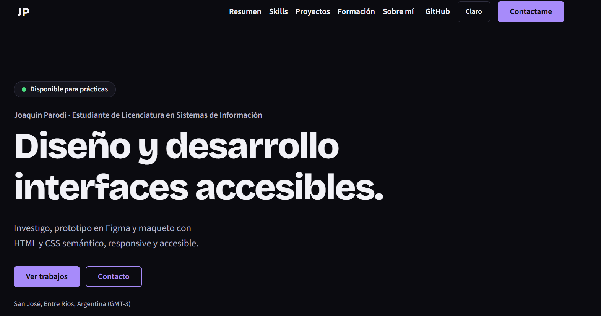
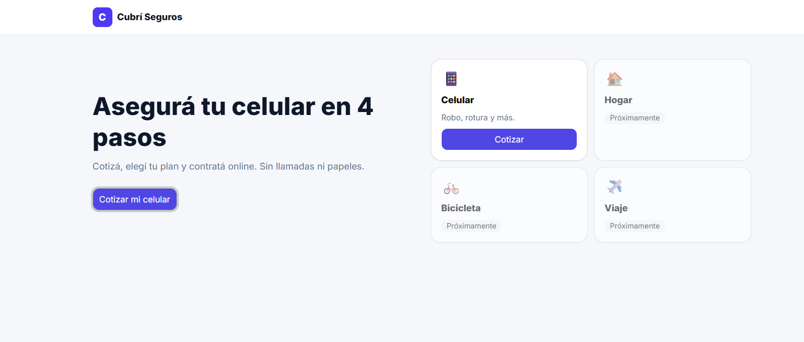
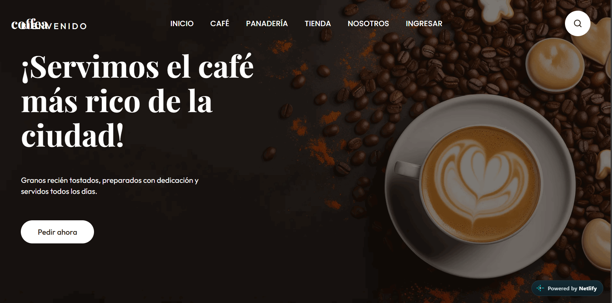
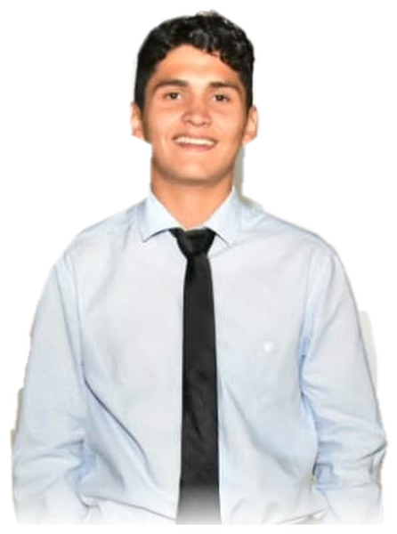

# Portfolio web personal · Joaquín Parodi

Trabajo final de **Diseño UX-UI 2026** · Licenciatura en Sistemas de Información · FCyT, Sede Concepción del Uruguay · Cátedra del Mg. Ernesto Ledesma.

## Enlaces

| Qué | Dónde |
|---|---|
| Sitio publicado | https://portpers.netlify.app |
| Repositorio | https://github.com/joaparodi/ux-ui (carpeta `portfolio-ux-ui`) |
| Figma del portfolio (un solo archivo con 3 páginas: Design System, Design System · Componentes y Research · Wireframes · Prototipo) | https://www.figma.com/design/U5EX87DpdOJDKsDdnTVcZG |
| Figma de BarberTurn | https://www.figma.com/make/IwDEMx60cwZLFeE5sRJtNY/Crear-app-interactiva?t=Gbi7JT6UshvwRUVa-1 |
| Figma de OpenArt (proyecto en grupo) | https://www.figma.com/make/06ILLeUcyiwDLk7DUeTGv5/Prototipo-de-aplicaci%C3%B3n-OpenArt?p=f&t=1dZcV8SkdeFC1BTF-0 |

## Referencias e inspiración (originalidad)

- **Referencia de la cátedra:** portfolio del docente (https://ernesto-ledesma-portfolio.vercel.app/). Otras fuentes de inspiración sugeridas: Behance (búsquedas "UX portfolio" y "case study"), Land-book, Godly y Minimal Gallery.
- **Qué se tomó como principio:** la arquitectura de información que exige el TP (one-page con las 9 secciones), el tema oscuro como punto de partida y la grilla de tarjetas para resumen, habilidades y proyectos.
- **Qué es propio:**
  - Paleta negro y violeta definida como design system en Figma (variables con los mismos nombres que en CSS) y modo claro opcional.
  - Tipografía Bricolage Grotesque y Source Sans 3.
  - Proyectos con capturas reales y casos de estudio (un modal y una página propia).
  - Línea de tiempo con puntos, foto recortada y textos y contenido propios.
- **Qué no se reutilizó:** logos, nombres, imágenes, textos ni códigos de color de la referencia ni de ninguna marca real.
- En el PDF del proceso va una slide "Referencia vs. mi diseño" con esta comparación.

## Concepto visual

- **Palabras clave:** claro, preciso, cercano. *(Confirmar o reemplazar según el moodboard final.)*
- **Color:** fondo negro con violeta como color de detalle; modo claro opcional con el botón del header.
- **Tipografía:** Bricolage Grotesque (títulos) y Source Sans 3 (texto), con `font-display: swap`.
- **Imágenes:** foto propia y mockups de los proyectos.

## Stack

HTML5 semántico, CSS3 puro (variables en `:root`, Flexbox y Grid) y JavaScript vanilla con módulos ES. Sin frameworks ni paso de compilación: el sitio se sirve tal como está en el repositorio. Se eligió CSS puro en lugar de Tailwind para evitar compilar y no depender del CDN.

## Estructura del proyecto

```
index.html        contenido, metadatos y caso de estudio (<dialog>)
css/styles.css    tokens del design system, componentes, secciones y breakpoints
js/main.js        punto de entrada que inicia los módulos
js/nav.js         menú mobile (aria-expanded y aria-controls)
js/scrollspy.js   marca la sección activa en el menú
js/theme.js       modo oscuro/claro
js/modal.js       caso de estudio en un modal nativo
js/case.js        tema oscuro/claro en la página de caso de estudio
assets/           favicon e imágenes
casos/           páginas propias de casos de estudio (barberturn.html)
docs/            capturas y plantilla del test de usabilidad
404.html          página de error personalizada
netlify.toml      configuración de Netlify y headers de seguridad
```

La separación en `index.html`, un CSS y un módulo JS por responsabilidad permite cambiar una parte sin romper el resto. El contenido y la navegación funcionan aunque JavaScript falle (mejora progresiva).

## Cumplimiento de los requisitos del TP

| Requisito | Dónde se resuelve |
|---|---|
| 9 secciones y navegación por anclas | `index.html` (`section` con `id`) |
| Header sticky y menú hamburguesa | `.site-header`, `js/nav.js` |
| Un solo `h1`, jerarquía sin saltos, `alt` y enlaces externos seguros | `index.html` |
| Variables CSS, Flexbox y Grid | `:root` y `.grid` en `css/styles.css` |
| Mobile-first y breakpoints 375, 768 y 1280 px | `@media` al final de `css/styles.css` |
| Estados `hover`, `focus-visible` y `active` | botones, enlaces y tarjetas |
| `scroll-behavior` y `scroll-margin-top` | `html` y `section[id]` |
| Contraste AA, teclado y link "Saltar al contenido" | `.skip-link`, tokens de color |
| `prefers-reduced-motion` | final de `css/styles.css` |
| Caso de estudio | página propia `casos/barberturn.html` y modal de Cubrí Seguros (`<template id="case-cubri">`) |
| Bonus: modo claro/oscuro, formulario, 404 y headers | `js/theme.js`, Netlify Forms, `404.html`, `netlify.toml` |

## Pruebas realizadas

- Navegador real (Chromium) en 375, 768 y 1280 px: sin scroll horizontal y sin errores de JavaScript.
- Menú mobile (abrir, cerrar y tecla Esc), modal, cambio de tema.
- Auditoría de HTML: un solo `h1`, sin saltos de encabezados, sin ids duplicados ni anclas rotas, imágenes con `alt`, `width` y `height`.
- Contraste de los pares de color de ambos temas, por encima de 4,5:1.
- **A completar:** reporte de Lighthouse mobile, corrido sobre la URL de producción (https://portpers.netlify.app) y no en local (captura en `docs/capturas/lighthouse-mobile.png`), WAVE o axe, y recorrido completo con teclado.

## Despliegue (Netlify desde GitHub)

1. Subir los cambios al repositorio (`git push origin main`).
2. En Netlify: **Add new site → Import an existing project → GitHub** y elegir el repo `ux-ui`.
3. Configurar **Base directory** = `portfolio-ux-ui`, **Build command** vacío y **Publish directory** = `.`
4. Cada push a `main` dispara un nuevo despliegue automático con HTTPS.
5. Agregar la URL en este README y en la descripción del repositorio (GitHub → About → engranaje → Website).

## Fuentes y recursos

- Sin template: el diseño y el código son propios para este trabajo.
- Fuentes: Google Fonts (Bricolage Grotesque y Source Sans 3).
- Capturas reales de Cubrí Seguros, Coffea y BarberTurn (esta última, de las pantallas del enunciado). Los mockups de OpenArt y Mesa de Ayuda son SVG provisorios creados para este proyecto. **A completar:** capturas reales de esos dos.
- Fotografía propia, recortada del fondo (recorte automático).

## Uso de IA

Se usó **Claude (Anthropic)** como asistente, según la política de la cátedra.

**Qué se generó con IA**
- El código inicial: HTML, CSS con variables y los módulos JavaScript (`nav`, `scrollspy`, `theme`, `modal` y `main`).
- Textos de ejemplo del sitio y los mockups SVG provisorios.
- El informe de conceptos clave del TP y este README.

**Qué es propio**
- Todos los datos personales, la elección y el contenido de los proyectos (trabajos reales de la carrera), la foto y los links.
- La decisión de la paleta negro y violeta, la elección de qué proyectos mostrar y su orden.
- El proceso UX/UI en Figma y el test de usabilidad. **A completar** cuando estén hechos.

**Cómo se revisó**
- Se leyó el código y se probó en un navegador en 375, 768 y 1280 px, con menú, modal y cambio de tema.
- Se auditó el HTML y se calculó el contraste de colores.
- Los textos de los proyectos se contrastaron con los documentos originales; se eliminaron o corrigieron las afirmaciones que no se podían verificar (por ejemplo, resultados de un test que todavía no se había hecho).
- **A completar:** qué revisé yo personalmente y qué cambié del código generado.

## Proceso UX/UI

| Etapa | Estado |
|---|---|
| Usuario objetivo y proto-persona | A completar |
| Benchmark de 3 portfolios | A completar |
| Moodboard y 3 palabras clave | A completar |
| Sitemap y card sorting | A completar (la estructura está en `index.html`) |
| Wireframes mobile y desktop | A completar |
| Design system en Figma | Hecho: variables, estilos de texto, espaciado y componentes (botón en 4 estados, etiqueta, campo, tarjeta, ítem de timeline) |
| Prototipo de alta fidelidad | A completar |
| Test de usabilidad con 3 personas | A completar (tabla de hallazgos en `docs/test-de-usabilidad.md`) |

## Capturas









*A completar:* home en mobile, comparación lado a lado de Figma y sitio en dos secciones, y el reporte de Lighthouse mobile del portfolio (`docs/capturas/lighthouse-mobile.png`).
